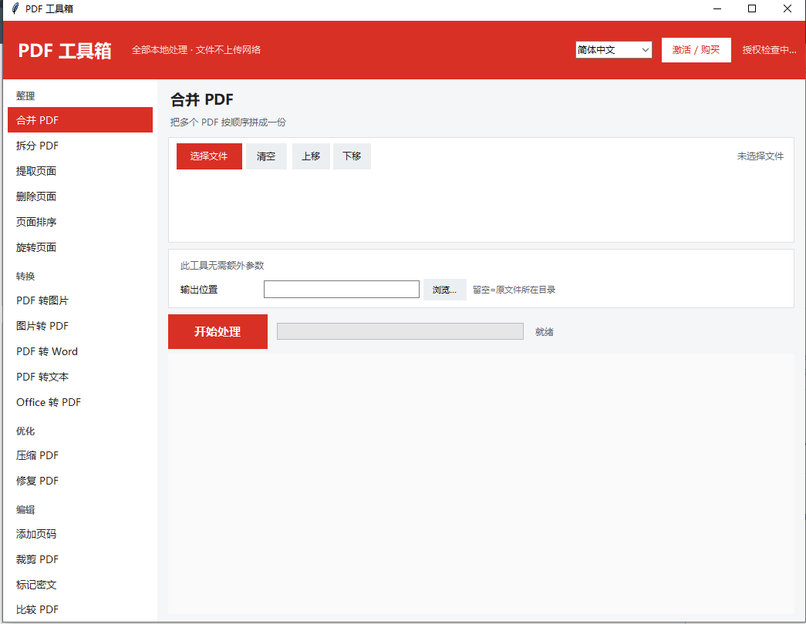
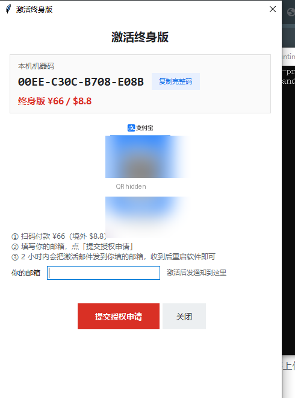

# PDF 工具箱

> 19 项 PDF 处理功能，**全部在你的电脑本地完成**，文件不上传、不联网、不排队。
> 一次买断 ¥66 / $8.8，终身使用，不限次数。



<p align="center">
  
</p>


官网与下载：**https://lic.cjers.top**

---

## 为什么做这个

在线 PDF 工具都要先把文件传到别人的服务器上。合同、病历、卷宗、身份证扫描件——
这些东西不该为了"转个格式"就先交出去。

市面上不缺 PDF 工具，缺的是一个**不用联网、不用订阅、打开就能用**的。

这个软件把 PDF 引擎（MuPDF）直接打包在程序里，所有处理都在你本机的内存和硬盘上完成。
拔掉网线，功能照常全部可用。

## 功能

**整理**
- 合并 PDF —— 多份按顺序拼成一份，可上下调序
- 拆分 PDF —— 按页数或自定义范围拆成多份
- 提取页面 —— 挑出指定页组成新文件
- 删除页面 —— 去掉不要的页
- 页面排序 —— 用页码表达式重排（如 `3,1,2,4-`）
- 旋转页面 —— 把倒着的扫描页转正

**转换**
- Office 转 PDF —— Word/Excel/PPT 直接转，批量支持，调用本机 Office，质量最好
- PDF 转图片 —— 每页导出 PNG/JPG，DPI 可调
- 图片转 PDF —— 多张照片合成一份，可选 A4 居中
- PDF 转 Word —— 转成可编辑 docx
- PDF 转文本 —— 提取文字存 txt

**优化**
- 压缩 PDF —— 三档强度（无损 / 中等 / 强力），最大可减 80%
- 修复 PDF —— 打不开的文件尝试重建结构

**编辑**
- 添加页码 —— 5 种位置、4 种格式，可设起始页码
- 裁剪 PDF —— 去掉白边或扫描黑边
- 标记密文 —— 按关键字涂黑并**彻底删除**底层文字（不是覆盖，不可还原）
- 比较 PDF —— 两份文件逐页对照，标注差异页

**安全**
- 加密 PDF —— AES-256 打开密码
- 解除密码 —— 知道密码时去掉加密
- 添加水印 —— 文字水印 + 可选页码

## 下载

| 版本 | 说明 |
|---|---|
| [Windows 精简版](https://github.com/cjer007/PDFToolBox/releases/latest/download/PDFToolBoxLite.zip) | 90 MB · 18 项（不含 PDF 转 Word） |
| [Windows 完整版](https://github.com/cjer007/PDFToolBox/releases/latest/download/PDFToolBox.zip) | 145 MB · 全部 19 项 |
| [macOS](https://github.com/cjer007/PDFToolBox/releases/latest/download/PDFToolBoxLite-mac.zip) | Apple Silicon / Intel |
| Android | 开发中 |

免安装，解压即用。不需要装 Python，不需要注册账号。

**系统要求**：Windows 10/11 64 位；macOS 11+

## 价格

**免费试用 5 次**，觉得好用再付。

| | 价格 |
|---|---|
| 终身版 | **¥66 一次买断**（境外 $8.8） |

不是订阅，没有月费年费。付一次，终身用，不限次数、不限文件大小、后续版本免费升级。

**激活流程**：

1. 打开软件 → 点右上角「激活 / 购买」，窗口里会显示你这台机器的机器码
2. 扫码付款（支付宝 ¥66，境外可用 PayPal $8.8）
3. 在窗口里填上**你自己的邮箱**，点「提交授权申请」
4. 2 小时内会有一封激活邮件发到你填的邮箱，收到后重启软件即可


## 多语言

首次启动会让你选界面语言，之后可在右上角随时切换。

简体中文 · English · 日本語 · Русский · Español

## 技术栈

- Python 3.12 + tkinter
- [PyMuPDF](https://pymupdf.readthedocs.io/) —— PDF 渲染与页面操作
- [pypdf](https://pypdf.readthedocs.io/) —— PDF 结构操作与加密
- [pdf2docx](https://github.com/dothinking/pdf2docx) —— PDF 转 Word
- pywin32 —— Windows 下调用本机 Office 做 Office→PDF
- PyInstaller —— 打包成免安装 exe

## 关于授权

软件启动时会发一次很小的网络请求做授权校验（只含机器码，**不含任何文件内容**）。
试用次数和付费状态都存在服务器端，本地只留一个签名缓存。

**断网不影响功能**：连续离线 3 次以内都能正常使用。

机器码由主板 UUID + 系统标识哈希生成，换电脑需要重新激活。

## 隐私

- 不收集你的文件
- 不收集你的使用习惯
- 不上传任何 PDF 内容
- 授权请求只传：机器码、主机名、功能名（用于统计哪个功能用得多）

## 项目结构

```
main.py              图形界面（tkinter）
pdf_engine.py        19 项功能的实现
license.py           授权校验与机器码
i18n.py              5 种语言的语言包
license_server/      授权服务端（纯标准库，无第三方依赖）
web/                 官网页面
build.ps1            Windows 打包脚本
.github/workflows/   GitHub Actions：自动构建 Windows 与 macOS
```

## 从源码运行

```bash
pip install pypdf pymupdf pdf2docx pywin32 pillow cryptography
python main.py
```

## 自己打包

```bash
# Windows
powershell -File build.ps1

# 或手动
pyinstaller --noconfirm --onedir --console --name PDFToolBox ^
  --add-data "pay_qr.png;." main.py
```

macOS 版由 GitHub Actions 自动构建（`.github/workflows/build.yml`），
打 `v*` 标签即可触发。

## 已知限制

- 「PDF 转 Word」和「标记密文」需要 PDF 有文字层。纯图片的扫描件需要先做 OCR。
- 「Office 转 PDF」在 Windows 上调用本机 Office；macOS 上需要装 LibreOffice。
- 授权绑定机器，暂不支持一个授权多机使用。

## 许可

商业软件，保留所有权利。详见 [LICENSE](LICENSE)。

---

作者：[cjer007](https://github.com/cjer007)
问题反馈：[Issues](https://github.com/cjer007/PDFToolBox/issues)
